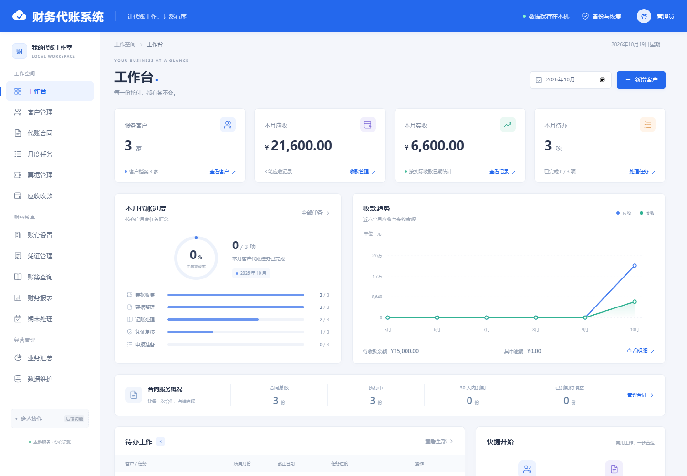

# 财务代账系统

给单个代账人员使用的中文客户、合同、月度任务与账务管理软件。提供 Windows EXE 桌面版和本机网页模式，业务数据保存在本机 SQLite，关闭后重新打开仍然保留。

[下载 Windows x64 桌面版](../../releases/latest) · [使用说明](docs/使用说明.md) · [构建与测试](docs/开发与验证.md)



顶栏和左侧导航保持固定，右侧业务内容独立滚动。[查看账套界面](docs/screenshots/accounts.png)。

## 已有功能

| 业务 | 可用操作 |
| --- | --- |
| 客户 | 新增、查看、编辑、归档；联系人、联系方式、状态、备注；搜索和状态筛选 |
| 合同 | 服务内容、期限、费用、收款周期、合同状态；客户、状态、到期筛选 |
| 月度任务 | 按客户和月份建立任务；资料收集、票据整理、记账、复核、报税准备五步的状态、日期和备注 |
| 票据 | 手动登记日期、类型、金额、编号、客户；本地附件随数据库保存 |
| 会计 | 建账、科目与期初余额；借贷平衡校验；凭证草稿、待复核、已完成；账簿、基础财务报表、结转与结账/反结账 |
| 应收收款 | 合同应收、到期日、多笔收款；自动计算未收和逾期 |
| 首页与报表 | 从数据库汇总客户、合同、任务、欠费、收款趋势；业务修改后刷新相关统计；CSV 导出 |
| 数据维护 | 可选虚构示例；完整备份与校验恢复；附件一并备份；恢复前自动保留当前数据副本 |
| 桌面 | 独立窗口、单实例、桌面快捷方式、原生保存对话框与凭证打印预览 |

不含进销存、项目核算、多人协同或云端同步。税务模块仅记录申报准备和处理状态，不连接真实税务、发票、支付平台，不代表完成真实申报。示例均为虚构；首次启动可选择载入，也可以直接建立自己的客户。

## Windows 双击使用

1. 在 [Releases](../../releases/latest) 下载 `Finance-Bookkeeping-System-v1.0.3-Windows-x64.zip`，解压到长期保留的文件夹。
2. 双击 `财务代账系统.exe`。EXE 已包含 Node.js 和业务代码，无须安装 npm 或启动终端。
3. 如需桌面入口，右键 `创建桌面快捷方式.ps1`，选择“使用 PowerShell 运行”。快捷方式指向解压目录，请勿随后移动或删除该目录。

运行环境：Windows 10/11 x64、.NET Framework 4.8、Microsoft Edge WebView2 Runtime。缺少组件时可从 [Microsoft .NET](https://dotnet.microsoft.com/download/dotnet-framework/net48) 和 [WebView2 官方页面](https://developer.microsoft.com/microsoft-edge/webview2/) 安装。EXE 未做商业代码签名，Windows 可能显示未知发布者；可对照 Release 的 SHA-256 校验。

## 数据与备份

改名版本完整保留原数据目录、SQLite 文件名和备份格式标识；首次打开会继续读取原有账务记录，无须重新建账或转换备份。下列路径中的 `YundaizhangDesktop`、`yundaizhang.sqlite` 和环境变量名属于兼容标识。

- EXE 默认数据：`%LOCALAPPDATA%\YundaizhangDesktop\data\yundaizhang.sqlite`，附件保存在同一 SQLite 数据库中。
- 桌面运行文件缓存：`%LOCALAPPDATA%\YundaizhangDesktop\runtime\`。更新 EXE 会使用新的运行文件目录，不清空业务数据库。
- 直接运行网页源码：项目下 `data/yundaizhang.sqlite`；用 `YUNDAIZHANG_DATA_DIR` 指定其他目录。
- 测试/便携隔离：`财务代账系统.exe --data-dir "D:\BookkeepingData"`。每个数据目录分别限制单实例。
- 请在“数据维护”中导出完整备份，妥善保存到其他磁盘。CSV 用于汇总交换，不是完整备份。恢复备份会替换当前业务数据，请先核对目标目录和备份来源。

数据库、备份和附件可能含客户资料；本仓库不包含这些文件，也请勿将它们作为 Issue 附件上传。当前数据库没有静态加密，适用于受信任的本机 Windows 账户。

## 从源码运行

需要 Node.js **24 或更新版本**（使用原生 `node:sqlite`）。在项目目录执行：

```powershell
npm ci
npm run build
npm start
```

浏览器打开 `http://127.0.0.1:3210`，终端按 Ctrl+C 停止。仅监听本机回环地址。Windows 也可在构建后双击 `启动财务代账系统.cmd`，用 `停止财务代账系统.cmd` 停止该启动器自己的后台进程。

开发界面：先 `npm start`，另一个终端运行 `npm run dev`，按 Vite 输出地址访问。默认代理本机 3210 端口。

## 构建 EXE

Windows x64，安装 Node.js 24+、Python 3.10+、.NET Framework 4.8 开发工具或系统 C# 编译器后执行：

```powershell
npm ci
npm run build:desktop
```

脚本从官方 NuGet 下载固定版本 WebView2 SDK 并校验 SHA-256，从 Node.js 官方源码下载对应运行时许可证；构建前端，再将生产依赖和本机 Node x64 运行时封装进 EXE。产物在 `release/`，中间文件在 `artifacts/`，不会读取业务 `data/`。首次构建需要网络。已有 SDK 可使用 `desktop/build.ps1 -SdkDirectory <目录>`。

## 测试

```powershell
npm test
npm run test:migration
npm run test:restart
npm run test:ui
npm run test:ui:extra
npm run test:layout
# 构建 EXE 后，在交互式 Windows 桌面执行：
npm run test:desktop
npm run test:native
```

浏览器测试默认使用 Windows Edge，可通过 `BROWSER_PATH` 指定 Chromium 可执行文件。桌面测试使用独立临时数据目录，不接触默认业务库；可以用 `YUNDAIZHANG_EXE_PATH` 指定待测 EXE。详细覆盖范围见 [验证说明](docs/开发与验证.md)。

## 目录

```text
src/           Vue 界面与图表
server/        Express、SQLite、业务与账务逻辑
tests/         后端、浏览器和重启测试
desktop/       WinForms + WebView2 桌面宿主、构建与集成测试
docs/          使用说明与虚构示例截图
```

## 常见问题

**关闭窗口后数据还在吗？** 在。桌面关闭会停止它自己的本地服务；再次启动读取原数据目录。移动 EXE 不会迁移数据库，备份请用“数据维护”。

**为什么显示本地网址？** 网页模式通过本机服务访问 SQLite；桌面模式将同一界面放在原生窗口中，仍只访问回环地址。没有账户登录、远程数据抓取或云端上传功能。

**会计科目能用于所有行业吗？** 预设依据小企业会计准则一级科目，明细为可调整的常用预设。基础报表和结转规则需按实际业务核对；暂不覆盖所有行业/准则和复杂税务规则。

**哪些功能还需扩展？** 自动票据识别、电子税务局对接、真实支付、行业报表、细化税种规则、自动更新、多人权限等需要额外业务规则；不在此版承诺范围内。

## 许可和来源

自有源代码采用 [MIT](LICENSE)。第三方运行时与依赖保持原有许可，见 [THIRD_PARTY_NOTICES.md](THIRD_PARTY_NOTICES.md)。界面布局参考公开网页的蓝色工作台形式，未复制参考站点源码、品牌素材或私人数据；软件为独立项目，与参考网站无隶属关系。截图中的公司、金额和任务均为虚构数据。
